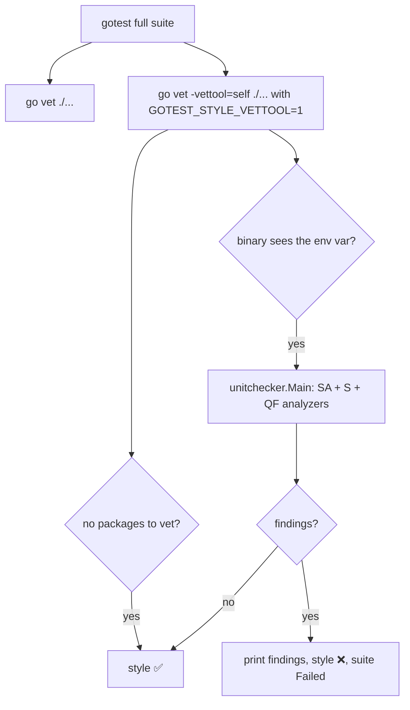

> Read AGENTS.md at the repo root before any change.
> **Finish by yourself:** when the delivery check passes, commit, push and open the pull request. Never ask whether to
> proceed or finalize — nobody answers, and a session that waits ends without your work. Commit after every stage; never
> run `git reset`, `git restore`, `git checkout -- <file>` or `git stash` on your own work. Stuck for 30 minutes: open the
> PR anyway and list what fails.

# Plan — `style` step in `gotest`

## 1. Problem

The editor (gopls) reports staticcheck findings such as `QF1003` ("could use tagged switch on x"). `gotest` only runs
`go vet`, so these findings never fail the suite and get overlooked.

The `staticcheck` CLI cannot be the answer: it does not know the `QF*` checks (`staticcheck -checks=QF1003 ./...`
prints nothing, `-list-checks` has no `QF`). The analyzers do exist as Go packages in `honnef.co/go/tools`.

## 2. Ecosystem search

Searched `webtyp/*` and `veltylabs/*` for `unitchecker`, `multichecker`, `staticcheck`, `honnef`: nothing. The only
related code is `vetWebMain` / the `go vet` call in `gotest.go`, which stay unchanged. Decision: **new**, inside
`devflow`, because `gotest` is the command that defines "done" for the whole ecosystem.

## 3. Design gate

1. **Prior art.** `golangci-lint` (external binary, per-repo config — rejected); `staticcheck` CLI (misses `QF`);
   `go vet -vettool=<binary>` (the protocol Go itself uses for external analyzers — chosen).
2. **Names.** Step label in the `gotest` output: `style`. Exported symbol: one function,
   `devflow.MaybeRunStyleTool()`. Nothing else is exported.
3. **Complexity ledger.** +1 exported function, +1 env var (unexported constant), +2 module dependencies.
   No flag, no config file, no per-repo opt-out.
4. **Where it belongs.** `devflow`, next to the `vet` step. `gotest` is installed as one binary
   (`go install webtyp.com/devflow/cmd/gotest@latest`), so the analyzers run **inside that same binary**: `gotest`
   launches `go vet -vettool=<its own path>` with the env var set, and the binary, seeing the variable, behaves as a vet
   tool instead of the CLI. No second binary to install.
5. **What it deletes.** Nothing public. It deletes dead code the new check finds in devflow itself (stage 5) and the
   duplicated "no packages" string checks (stage 4).

## 4. Tools

```bash
go install webtyp.com/devflow/cmd/gotest@latest
```

Pin the new dependencies (resolved and verified before writing this plan):

```bash
go get honnef.co/go/tools@v0.7.0 golang.org/x/tools@v0.52.0
go mod tidy
```

## 5. APIs used

| symbol | exact signature | tag | file |
|---|---|---|---|
| `unitchecker.Main` | `func Main(analyzers ...*analysis.Analyzer)` — never returns (calls `os.Exit`) | `golang.org/x/tools@v0.52.0` | `go/analysis/unitchecker/unitchecker.go` |
| `quickfix.Analyzers` | `var Analyzers []*lint.Analyzer` (each has field `Analyzer *analysis.Analyzer`) | `honnef.co/go/tools@v0.7.0` | `quickfix/analysis.go` |
| `simple.Analyzers` | `var Analyzers []*lint.Analyzer` | `honnef.co/go/tools@v0.7.0` | `simple/analysis.go` |
| `staticcheck.Analyzers` | `var Analyzers []*lint.Analyzer` | `honnef.co/go/tools@v0.7.0` | `staticcheck/analysis.go` |
| `GoTestCmdFn` | `var GoTestCmdFn = testCommand` — `func(ctx context.Context, dir, name string, args ...string) *exec.Cmd` | this repo | `gotest.go:23` |
| `(*Go).SetConsoleOutput` | `func (g *Go) SetConsoleOutput(fn func(string))` | this repo | `go_handler.go` |

`lint.Analyzer` is `honnef.co/go/tools/analysis/lint`. If a signature in the published tag differs from this table,
stop and name the symbol in the PR; never adapt it by guessing.

Proof that this wiring works (verified manually before writing the plan): a `main` calling
`unitchecker.Main(...)` with these three lists, run as `go vet -vettool=./that ./...`, prints
`b.go:12:2: could use tagged switch on s` and exits 1.

## 6. Behaviour (worked examples)

Families blocked (the owner chose them): `SA*` (probable bugs), `S*` (simplifications), `QF*` (editor quick fixes).
`ST*` (naming/comment style) is **not** included.

| source in the repo under test | `style` result | output line |
|---|---|---|
| `if s == A {…} else if s == B {…} else if s == C {…}` on one value | `style ❌` | `could use tagged switch on s` (QF1003) |
| `if ok { return true }; return false` | `style ❌` | `should use 'return ok' instead of …` (S1008) |
| `return a == a` | `style ❌` | `identical expressions on the left and right side of the '==' operator` (SA4000) |
| clean code | `style ✅` | — |
| a module whose packages are all excluded by build constraints | `style ✅` | — (same tolerance as `vet`) |

A failure sets `testStatus = "Failed"` and prints the tool output through `g.consoleOutput`. `gotest` with custom
args (fast path) skips `style`, exactly like `vet`.

## 7. Stages

### Stage 1 — dependencies

Run the two commands of «Tools». Commit `go.mod` / `go.sum`. Nothing else.

### Stage 2 — diagram first

Create `docs/diagrams/GOTEST_STYLE.md` in the three-part template of **documentation** (context header, `flowchart TD`,
numbered walkthrough):



### Stage 3 — red tests

File `tests/style_test.go` (package `devflow_test`). First edit `tests/main_test.go`: the first line of `TestMain` becomes
`devflow.MaybeRunStyleTool()` (the test binary is the vet tool in these tests), and add the import
`"webtyp.com/devflow"`.

```go
package devflow_test

import (
	"context"
	"os"
	"os/exec"
	"path/filepath"
	"strings"
	"testing"

	gitmod "webtyp.com/git"

	"webtyp.com/command"
	"webtyp.com/devflow"
)

// runStyle writes src as main.go of a temp module and runs the full suite with the
// toolchain mocked except for the `go vet -vettool=...` call, which runs for real.
// It returns the summary line and everything printed to the console.
func runStyle(t *testing.T, src string) (summary, console string) {
	t.Helper()
	dir, cleanup := testCreateGoModule("example.com/styletest")
	defer cleanup()
	if err := os.WriteFile(filepath.Join(dir, "main.go"), []byte(src), 0644); err != nil {
		t.Fatal(err)
	}

	git, _ := gitmod.NewGit()
	g, _ := devflow.NewGo(git)
	g.SetRootDir(dir)
	var out strings.Builder
	g.SetConsoleOutput(func(s string) { out.WriteString(s + "\n") })

	origCmd, origExec := devflow.GoTestCmdFn, command.Exec
	t.Cleanup(func() { devflow.GoTestCmdFn, command.Exec = origCmd, origExec })
	devflow.GoTestCmdFn = func(ctx context.Context, d, name string, args ...string) *exec.Cmd {
		if len(args) > 0 && args[0] == "vet" && hasArgWithPrefix(args, "-vettool=") {
			c := exec.CommandContext(ctx, name, args...)
			c.Dir = d
			return c
		}
		return exec.Command("true")
	}
	command.Exec = func(name string, args ...string) *exec.Cmd {
		if name == "go" {
			return exec.Command("true")
		}
		return origExec(name, args...)
	}

	summary, _ = g.Test(devflow.TestOptions{NoCache: true})
	return summary, out.String()
}

func TestStyle_TaggedSwitchFails(t *testing.T) {
	src := `package main

type St string

const (
	A St = "a"
	B St = "b"
	C St = "c"
)

func H(s St) int {
	if s == A {
		return 1
	} else if s == B {
		return 2
	} else if s == C {
		return 3
	}
	return 0
}

func main() {}
`
	summary, console := runStyle(t, src)
	if !strings.Contains(summary, "style ❌") {
		t.Fatalf("summary %q lacks style ❌", summary)
	}
	if !strings.Contains(console, "could use tagged switch on s") {
		t.Fatalf("console %q lacks the QF1003 message", console)
	}
}

func TestStyle_SimplifyFails(t *testing.T) {
	src := "package main\n\nfunc B(ok bool) bool {\n\tif ok {\n\t\treturn true\n\t}\n\treturn false\n}\n\nfunc main() {}\n"
	summary, console := runStyle(t, src)
	if !strings.Contains(summary, "style ❌") || !strings.Contains(console, "should use 'return ok'") {
		t.Fatalf("summary %q console %q", summary, console)
	}
}

func TestStyle_BugFails(t *testing.T) {
	src := "package main\n\nfunc A(a int) bool { return a == a }\n\nfunc main() {}\n"
	summary, console := runStyle(t, src)
	if !strings.Contains(summary, "style ❌") || !strings.Contains(console, "identical expressions") {
		t.Fatalf("summary %q console %q", summary, console)
	}
}

func TestStyle_CleanPasses(t *testing.T) {
	summary, _ := runStyle(t, "package main\n\nfunc main() {}\n")
	if !strings.Contains(summary, "style ✅") {
		t.Fatalf("summary %q lacks style ✅", summary)
	}
}

func TestStyle_NoPackagesPasses(t *testing.T) {
	src := "//go:build never\n\npackage main\n\nfunc main() {}\n"
	summary, _ := runStyle(t, src)
	if !strings.Contains(summary, "style ✅") {
		t.Fatalf("summary %q lacks style ✅", summary)
	}
}
```

If `hasArgWithPrefix` is not visible, it is defined in `tests/gotest_options_test.go` (same package) — reuse it.

Create `docs/TESTS.md` row only if the file exists in the repo (it does not today: skip). The tests must **fail** at the end of
this stage (`MaybeRunStyleTool` does not exist yet → compile error is the red state). Commit.

### Stage 4 — implementation

**New file `style.go`** (package `devflow`):

```go
package devflow

import (
	"os"

	"golang.org/x/tools/go/analysis"
	"golang.org/x/tools/go/analysis/unitchecker"
	"honnef.co/go/tools/analysis/lint"
	"honnef.co/go/tools/quickfix"
	"honnef.co/go/tools/simple"
	"honnef.co/go/tools/staticcheck"
)

// styleToolEnv, when set, makes the gotest binary behave as a `go vet -vettool`
// running the style analyzers instead of the CLI.
const styleToolEnv = "GOTEST_STYLE_VETTOOL"

// styleFlagPrefix is the argument that points `go vet` to the tool binary.
const styleFlagPrefix = "-vettool="

// MaybeRunStyleTool turns the process into the style vet tool when styleToolEnv is
// set; otherwise it returns at once. Call it first thing in main (and in TestMain).
// Example: func main() { devflow.MaybeRunStyleTool(); … }
func MaybeRunStyleTool() {
	if os.Getenv(styleToolEnv) == "" {
		return
	}
	unitchecker.Main(styleAnalyzers()...)
}

// styleAnalyzers lists SA (bugs), S (simplifications) and QF (quick fixes).
// ST (naming and comment style) is deliberately absent.
func styleAnalyzers() []*analysis.Analyzer {
	var all []*analysis.Analyzer
	for _, group := range [][]*lint.Analyzer{quickfix.Analyzers, simple.Analyzers, staticcheck.Analyzers} {
		for _, l := range group {
			all = append(all, l.Analyzer)
		}
	}
	return all
}
```

**New file `style_run.go`** (package `devflow`):

```go
package devflow

import (
	"context"
	"fmt"
	"os"
	"strings"
)

// noPackagesToVet reports whether go's output only says the module has nothing to analyse
// (WASM-only modules). Shared by the vet and style steps.
func noPackagesToVet(output string) bool {
	return strings.Contains(output, "matched no packages") ||
		strings.Contains(output, "no packages to vet") ||
		strings.Contains(output, "build constraints exclude all Go files")
}

// runStyle runs the style analyzers over the module through `go vet -vettool=<this binary>`.
// It returns the tool output and whether the step failed.
func (g *Go) runStyle(runAll bool) (output string, failed bool, err error) {
	self, err := os.Executable()
	if err != nil {
		return "", true, fmt.Errorf("style: cannot locate the gotest binary: %w", err)
	}
	args := []string{"vet", styleFlagPrefix + self}
	if runAll {
		args = append(args, "-tags=integration")
	}
	args = append(args, "./...")

	cmd := GoTestCmdFn(context.Background(), g.rootDir, "go", args...)
	cmd.Env = append(os.Environ(), styleToolEnv+"=1")
	var out strings.Builder
	cmd.Stdout = &out
	cmd.Stderr = &out
	if runErr := cmd.Run(); runErr != nil {
		if noPackagesToVet(out.String()) {
			return out.String(), false, nil
		}
		return out.String(), true, nil
	}
	return out.String(), false, nil
}
```

(The `err` return exists only for the `os.Executable` failure; the caller prints it and counts the step as failed.)

**Edit `gotest.go`** — three changes:

1. Replace the string checks at `gotest.go:131-133` (`strings.Contains(vetOutput, "matched no packages") || …`) with
   `if noPackagesToVet(vetOutput) {` — one definition, no duplicate.
2. Phase 1 becomes three goroutines (`wg1.Add(3)`); the third runs the style step and stores
   `styleOutput, styleFailed, styleErr`:

```go
	var styleOutput string
	var styleFailed bool
	var styleErr error
	// … inside the goroutines block:
	go func() {
		defer wg1.Done()
		styleOutput, styleFailed, styleErr = g.runStyle(runAll)
	}()
```

3. Right after the `vet` result block (after the closing brace of `if vetErr != nil { … } else { … }`), add:

```go
	// Style: staticcheck SA, S and QF checks (see style.go).
	if styleErr != nil {
		styleFailed = true
		styleOutput = styleErr.Error()
	}
	addMsg(!styleFailed, "style")
	if styleFailed {
		testStatus = "Failed"
		g.consoleOutput(styleOutput)
	}
```

   `testStatus` is assigned `"Failed"` at its declaration and later set `"Passing"` only by the test results; check
   how the existing code decides `testStatus` after the stdlib tests run and make sure a style failure is **not
   overwritten back to `"Passing"`**: if the existing code assigns `testStatus = "Passing"` unconditionally, change that
   assignment to run only when `!styleFailed`. Cover this with the existing `TestStyle_*Fails` tests: they assert
   the summary, and the function must return a non-nil error (the final `if testStatus == "Failed" || …` already
   does that).

**Edit `cmd/gotest/main.go`**: first statement of `main()` becomes `devflow.MaybeRunStyleTool()` (before `usage` and
`ParseCLIArgs`). No other change to the file.

Run `gotest`: the five `TestStyle_*` tests pass. Other tests keep passing because their mocked `go` returns success
for the style call too. The repo itself will now fail `style` until stage 5 — that is expected; commit anyway.

### Stage 5 — fix every finding in devflow

`gotest` now rejects devflow's own code. Findings at the time of writing (line numbers shift as you edit — re-run
`go vet -vettool=<gotest binary with GOTEST_STYLE_VETTOOL=1>` through `gotest` and clear everything it prints):

```
cascade.go:287:3: could use tagged switch on e.Status
codejob.go:139:2: could use tagged switch on status
frontmatter.go:184..217 (12 lines): Use fmt.Fprintf(...) instead of WriteString(fmt.Sprintf(...))
gotest.go:1023:3: Use fmt.Fprintf(...) instead of WriteString(fmt.Sprintf(...))
badges.go:265:21: calling regexp.MatchString in a loop has poor performance, consider using regexp.Compile
cli.go:100:2: empty branch
go_mod.go:265:3: empty branch
gotest.go:462:2: empty branch
cmd/gopush/main.go:38:3: could use tagged switch on arg
tests/codejob_ci_test.go:150:3: could use tagged switch on full
tests/codejob_state_test.go:117:3: could use tagged switch on full
tests/codejob_state_test.go:161:3: could use tagged switch on full
tests/dotenv_test.go:75:2: this value of val is never used
```

How to fix each kind (never suppress with `//lint:ignore` or `nolint`):

| Finding | Fix |
|---|---|
| tagged switch | convert the `if/else if` chain into `switch x { case …: … }`, same behaviour, same order |
| `WriteString(fmt.Sprintf(` | `fmt.Fprintf(&b, "…", args)` on the same builder |
| `regexp.MatchString` in a loop | package-level `var xRe = regexp.MustCompile(pattern)` declared once (the pattern as a named constant), used in the loop |
| `empty branch` | `gotest.go:462` is the `if checkFileExists("LICENSE") { // naive check }` block next to `licenseType := "MIT"`: delete the whole `if`. For `cli.go:100` and `go_mod.go:265`, read the branch: delete it, or invert the condition so the useful code is the branch body |
| `value of val is never used` | use the value in the test's assertion, or drop the assignment |

After the fixes, `grep -rn "lint:ignore\|nolint" --include=*.go .` must print nothing.

### Stage 6 — documentation

Only these edits (do **not** restructure the README):

- `docs/GOTEST.md`: in «What it does → Without arguments», add after `1. Runs go vet ./...` the step
  `2. Runs the style analyzers (staticcheck SA, S and QF checks) through go vet -vettool; findings fail the suite`
  and renumber the following steps (the file has a typo `23.` — make it a normal numbered list). Add a short section
  «Style checks» stating: families blocked (`SA`, `S`, `QF`), `ST` not included, no configuration, why the `staticcheck`
  CLI is not used (it lacks `QF`), and that the fast path (`gotest -run …`) skips it. In the example output line
  add `style ✅` after `vet ✅`. Link `docs/diagrams/GOTEST_STYLE.md`.
- `README.md`: where `gotest` is described as running vet, add «and style checks». Keep the file ≤ 150 lines.
- `docs/diagrams/GOTEST_STYLE.md` already exists (stage 2): make sure its walkthrough numbers match the final code.

## 8. Anti-footguns

- This repo is backend tooling that does **not** compile to WASM: stdlib (`os`, `os/exec`, `strings`) is legitimate, do not
  replace it with `webtyp.com/*` browser packages.
- Do **not** add a `staticcheck.conf`, a flag, an env var to disable the step, or an `ST*` analyzer.
- Do **not** call the `staticcheck` binary: it is not installed in CI.
- Do not edit generated files.
- `unitchecker.Main` calls `os.Exit`: never call it from anywhere except `MaybeRunStyleTool`, and never with the env var unset.

## 9. Delivery check

Environment: `GOPRIVATE=webtyp.com/*,github.com/veltylabs/*`, `GOFLAGS=-mod=mod`.

1. `gotest` prints `style ✅` and the whole suite passes. **A PR that does not compile, or whose tests could not run, is
   a failed delivery.**
2. `grep -rn "lint:ignore\|nolint" --include=*.go .` → empty.
3. `grep -rn '"matched no packages"' --include=*.go .` → exactly one match (inside `noPackagesToVet`).
4. `git diff --stat main` lists only: `go.mod`, `go.sum`, `style.go`, `style_run.go`, `gotest.go`, `cmd/gotest/main.go`,
   `tests/main_test.go`, `tests/style_test.go`, `docs/GOTEST.md`, `docs/diagrams/GOTEST_STYLE.md`, `README.md`, and the
   files named in stage 5.

## 10. Stages table

| # | Stage | Files |
|---|---|---|
| 1 | dependencies | `go.mod`, `go.sum` |
| 2 | diagram | `docs/diagrams/GOTEST_STYLE.md` |
| 3 | red tests | `tests/style_test.go`, `tests/main_test.go` |
| 4 | implementation | `style.go`, `style_run.go`, `gotest.go`, `cmd/gotest/main.go` |
| 5 | fix devflow findings | files listed in stage 5 |
| 6 | documentation | `docs/GOTEST.md`, `README.md`, `docs/diagrams/GOTEST_STYLE.md` |
