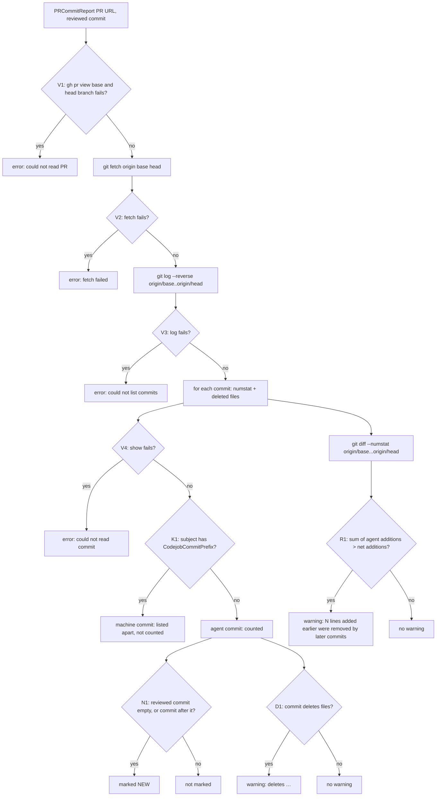
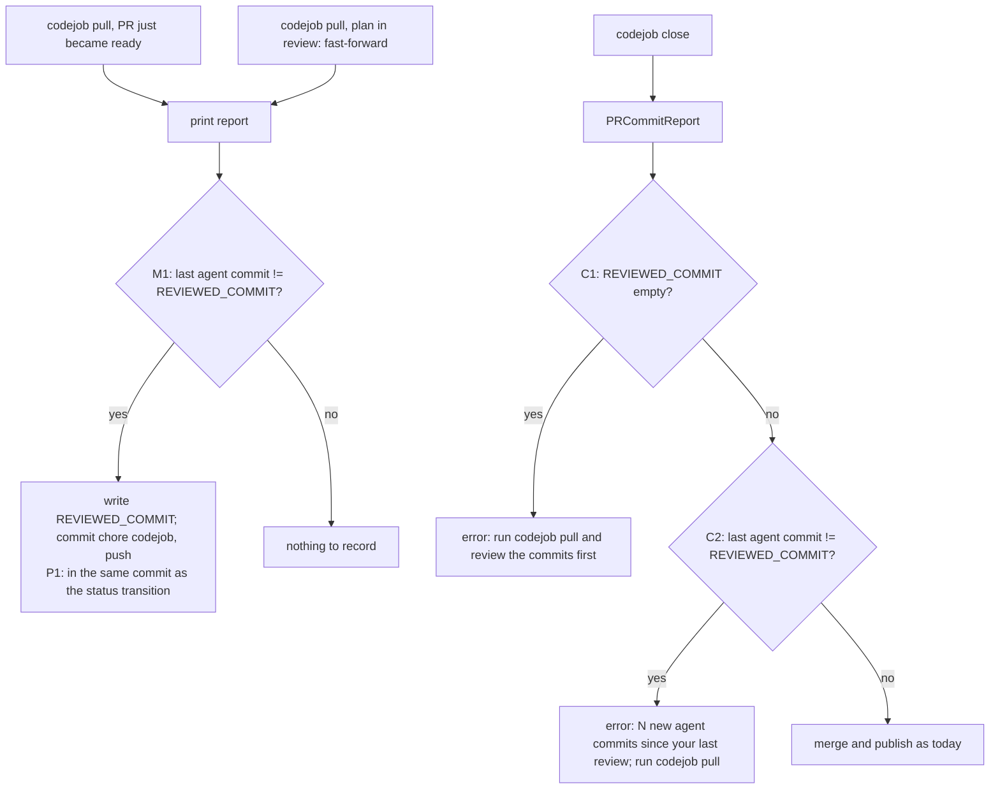

# codejob — reviewing a PR commit by commit

Every diamond has an id. The traceability table in [`docs/PLAN.md`](../PLAN.md) §6 maps each
branch to its test. A branch without a test is a defect.

## 1. Building the commit report (`PRCommitReport`)

## 2. Where the report is printed and recorded

The review mark is the **last agent commit** (`REVIEWED_COMMIT`), never the branch head: codejob's
own commits (status transitions, this mark itself) move the head and must not count as news.

