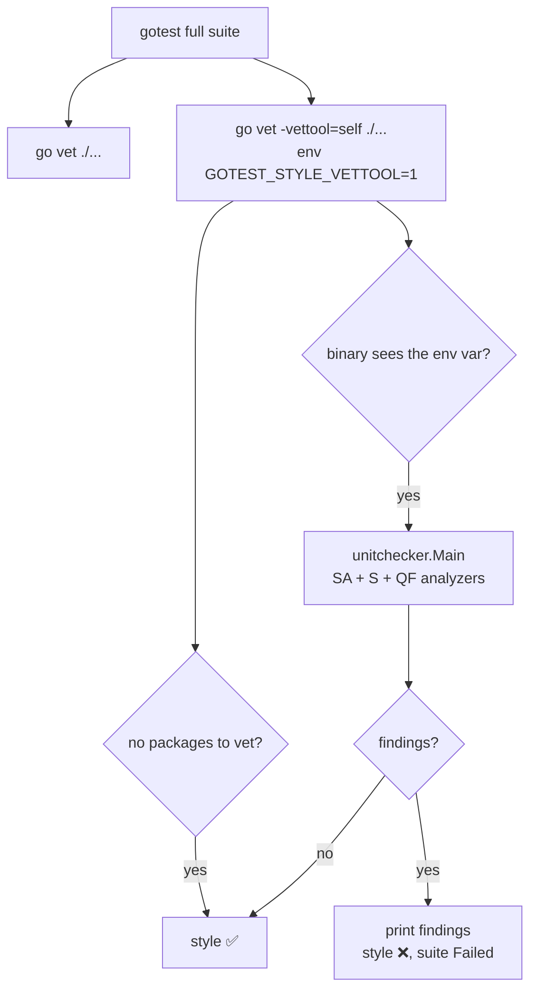

# gotest Style Flow

The `style` step of the full suite: staticcheck `SA`, `S` and `QF` checks run through `go vet -vettool=<the gotest binary itself>`. The fast path (`gotest -run ...`) skips it.

1. `gotest` starts the `vet` and `style` steps in parallel.
2. `style` runs `go vet` with `-vettool` pointing to the running `gotest` binary and the env var set.
3. `go` launches that binary as a vet tool; `MaybeRunStyleTool` sees the variable and hands control to `unitchecker.Main`.
4. The analyzers are the three groups of `honnef.co/go/tools`: `quickfix` (QF), `simple` (S), `staticcheck` (SA). `ST` is not included.
5. Findings make the step fail: they are printed and the suite fails.
6. Output that only says there is nothing to analyse (WASM-only modules) counts as passing, like `vet`.
